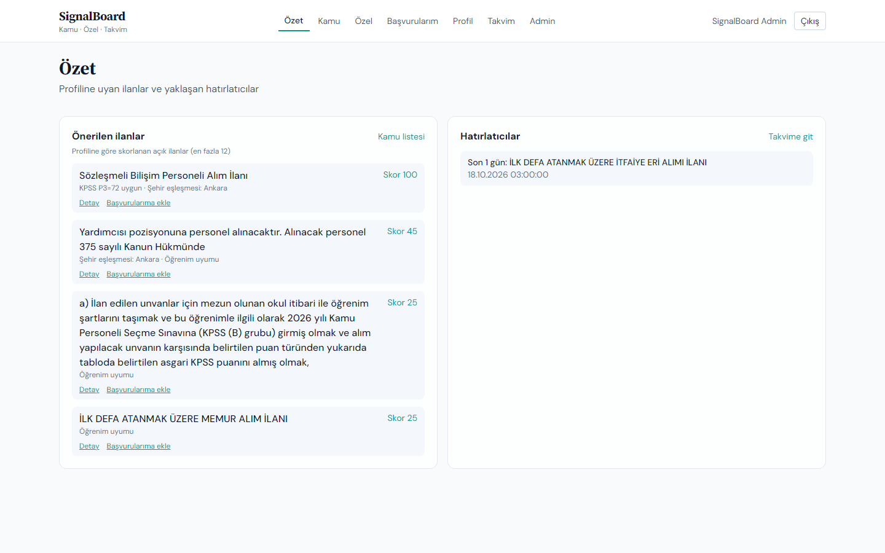
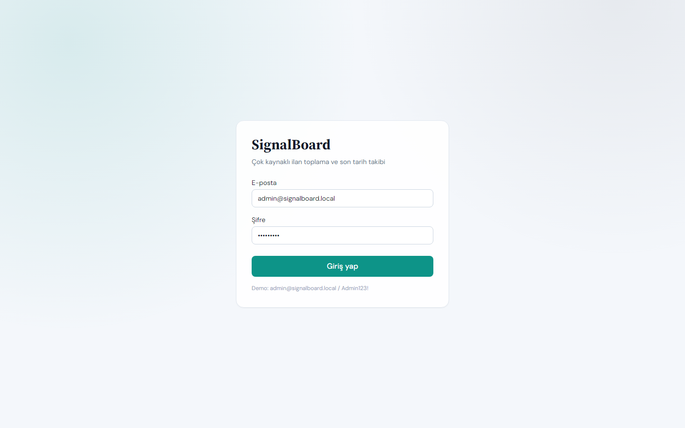
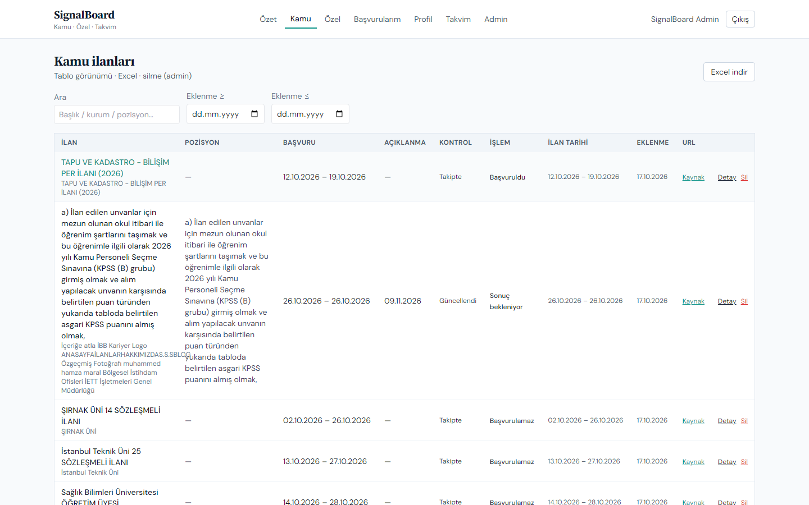
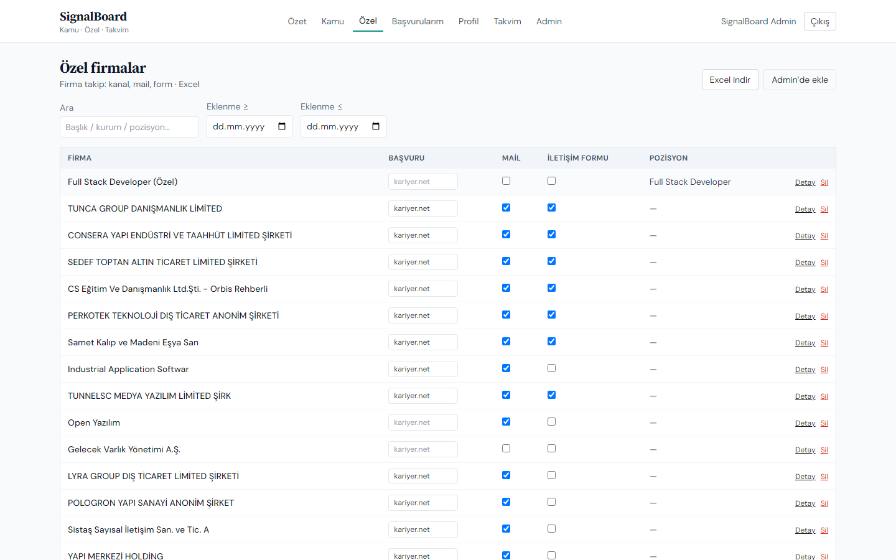
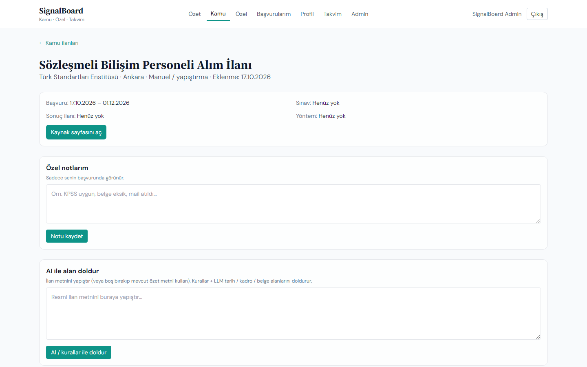
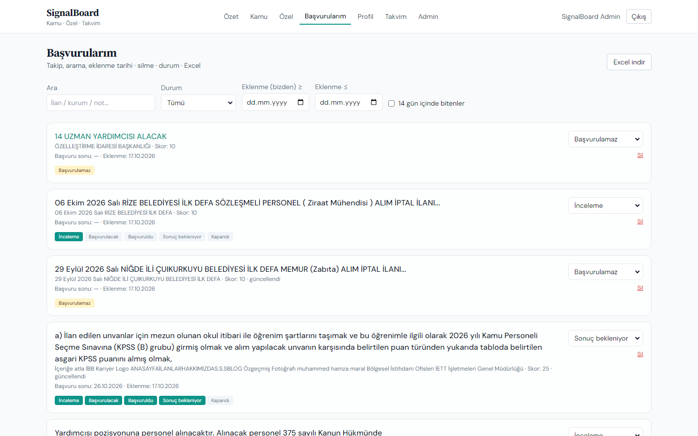
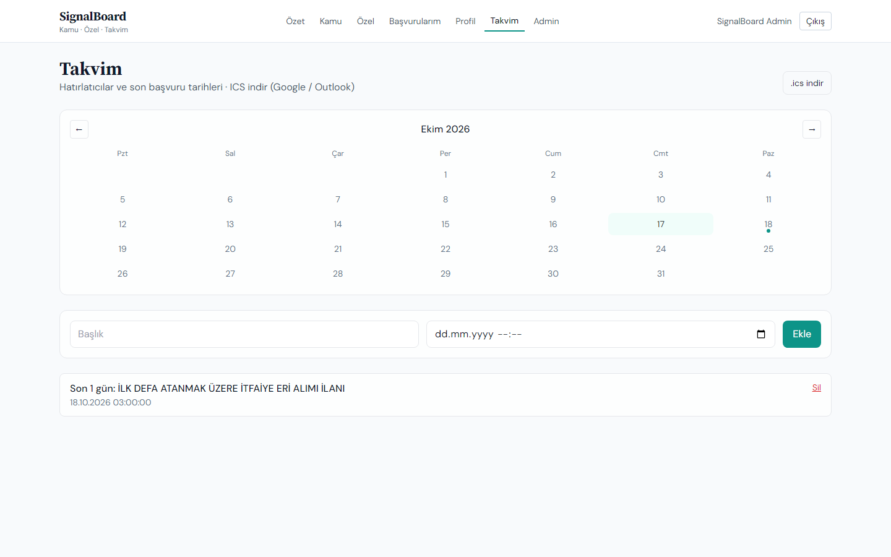
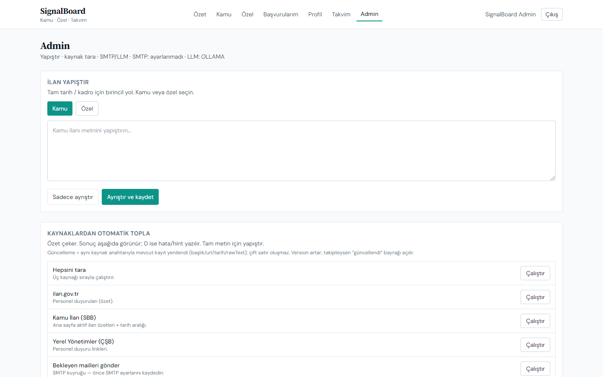

# SignalBoard Web


**SignalBoard**, kamu ve özel ilanları tek panelde toplayan, profil skoru ve son tarih takibi sunan bir showcase uygulamasıdır.
Bu repo arayüzdür; API ayrı tutulur.

| Repo | İçerik |
| ---- | ------ |
| **SignalBoard-web** (bu repo) | React SPA |
| [SignalBoard-api](https://github.com/hamzamaral/SignalBoard-api) | NestJS API, Prisma, PostgreSQL |



## Ekranlar

| | |
| --- | --- |
|  |  |
| **Giriş:** demo hesap, JWT oturum | **Özet:** profil skorlu öneriler ve yaklaşan hatırlatıcılar |
|  |  |
| **Kamu:** arama, filtre, Excel, takip durumu | **Özel:** aynı liste akışı, `kind=PRIVATE` |
|  |  |
| **İlan detayı:** tarihler, kadrolar, not, AI zenginleştirme | **Başvurularım:** durum timeline, iptal / başvurulamaz, Excel |
|  |  |
| **Takvim:** ay görünümü, hatırlatıcı, `.ics` dışa aktarma | **Admin:** yapıştır, kaynak tara, SMTP / LLM |

## Özellikler

- **Özet:** profile göre skorlanan açık ilanlar (en fazla 12), yaklaşan hatırlatıcılar
- **Kamu / Özel listeler:** arama (Türkçe katlama), kaynak / tarih filtreleri, Excel indirme
- **İlan detayı:** başvuru pencereleri, kadro tablosu, notlar, isteğe bağlı LLM zenginleştirme
- **Başvurularım:** Yeni → İnceleme → Başvurulacak → Başvuruldu → Sonuç bekleniyor → Kapandı; ayrıca **Başvurulamaz** ve **İptal edildi**
- **Takvim:** ay görünümü + ICS
- **Profil:** KPSS / öğrenim / şehir tercihleri (öneri skoruna yansır)
- **Admin:** kamu veya özel metin yapıştır → ayrıştır / kaydet; kaynak özet tarama; SMTP ve LLM ayarları

## Stack

React 18 · Vite · TypeScript · TanStack Query · React Router 6 · Tailwind · Axios (refresh kuyruğu) · Sonner

## Hızlı başlangıç

```bash
npm install
npm run dev
```

http://localhost:5173 — `/api` → `http://localhost:3000` proxy

API’nin ayakta olması gerekir. Demo: `admin@signalboard.local` / `Admin123!`

## Bağımlı API

Ayarlar ve iş kuralları [SignalBoard-api](https://github.com/hamzamaral/SignalBoard-api) üzerindedir:
paste-parse, scrape özet, pipeline, hatırlatıcı / ICS, SMTP kuyruğu, LLM.
